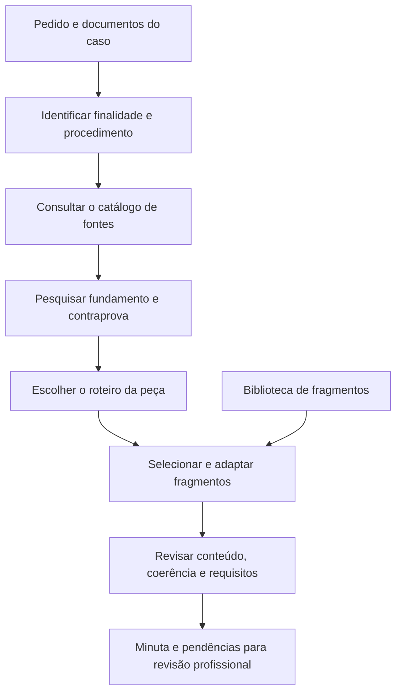

# Desenho das fontes de consulta e dos fragmentos de redação

Estudo registrado em 15/11/2026. O catálogo de fontes e a biblioteca editorial de fragmentos podem ser consultados neste repositório. Sua integração às rotinas instaláveis ainda está pendente.

O Juriswany precisa encontrar fundamentos e conferir objeções durante a pesquisa jurídica. Para redigir, precisa de blocos reutilizáveis que atendam à finalidade da peça, aos fatos e ao procedimento. A proposta separa essas duas responsabilidades e acrescenta roteiros de composição.

## Duas bases e roteiros de composição

| Material | Conteúdo | Responsabilidade |
| --- | --- | --- |
| [Catálogo de fontes](fontes.md) | Portais, acervos e serviços de consulta, classificados em uma ou mais categorias. | Indicar onde buscar e conferir o conteúdo jurídico pertinente. |
| [Índice da biblioteca de fragmentos](fragmentos.md) | Capítulos por função, com critérios de escolha, cuidados e exemplos autorais. | Localizar uma redação adaptável aos dados do caso. |
| [Roteiros de composição](fragmentos/roteiros.md) | Funções a preencher, ordem, variações e exigências específicas de cada peça. | Selecionar os fragmentos adequados e tornar visível o que ainda falta. |

Os fragmentos pretendidos são partes de redação de peças e comunicações. Trechos de leis e julgados podem servir de fundamento durante a pesquisa. Uma citação só entra na redação depois da conferência da fonte e de sua pertinência.

## Pesquisa com suporte e contraprova

A regra proposta para conteúdo jurídico pesquisado exige tentar obter pelo menos um fundamento oficial efetivamente consultado e sempre realizar uma busca de contraprova. O registro de uma fonte no catálogo não significa que um documento dela já foi lido.

Neste desenho, contraprova da pesquisa significa procurar o que pode refutar, restringir ou atualizar a conclusão. O termo descreve o método de conferência. Não atribui automaticamente valor de prova processual ao resultado de uma busca.

A conferência precisa distinguir dois trabalhos.

1. Confirmar a identidade, o texto, a versão e o alcance do fundamento. Quando possível, usar outra rota oficial e identificar se ela reproduz a mesma origem.
2. Procurar alteração, exceção, distinção, decisão posterior ou argumento contrário que possa mudar a conclusão. Registrar o que a busca encontrou e o que permaneceu sem confirmação.

Uma reprodução do mesmo texto em dois portais ajuda a conferir o conteúdo. Ela não constitui uma posição independente sobre a questão. Uma notícia e o acórdão que ela resume também compartilham a mesma origem. A categoria, o território e o órgão competente orientam a escolha das fontes. A quantidade de resultados não decide a força do fundamento.

O resultado da tentativa de contraprova pode ser um limite encontrado, uma objeção afastada com justificativa, uma busca sem resultado no recorte examinado ou uma conferência pendente por falta de acesso. O agente não inventa divergência para completar a entrega e não trata uma busca vazia como prova de inexistência de exceção.

Se o suporte oficial não puder ser consultado, a pesquisa conserva a pendência. O agente pode organizar os fatos e preparar partes da redação que tenham suporte, com lacunas identificadas. Uma conclusão decisiva sem verificação não recebe o rótulo de confirmada.

## Registro mínimo por questão jurídica

Cada questão que pode mudar a conclusão tem um registro de trabalho com os seguintes dados.

| Campo | Conteúdo |
| --- | --- |
| Pergunta | A questão que muda a análise, a providência ou a redação. |
| Contexto | Jurisdição, procedimento, posição da pessoa atendida, fatos relevantes e datas aplicáveis. |
| Suporte | Identificador da fonte do catálogo, documento efetivamente lido, dispositivo ou passagem, URL e data de consulta. |
| Aplicação | O que o fundamento sustenta e quais fatos do caso permitem a aproximação. |
| Contraprova | Acervos e termos consultados, distinção ou objeção encontrada, resultado e limite de acesso. |
| Consequência | Conclusão condicionada, prova faltante e informação que mudaria a escolha. |

Esse registro pertence ao trabalho privado do caso. O catálogo público não recebe nomes de clientes, anexos, números de processos do atendimento ou o histórico das consultas. Identificadores públicos de precedentes podem constar das referências quando necessários para reencontrá-los.

As consultas externas usam apenas os dados necessários para a pesquisa. Combinações de fatos raros também podem identificar uma pessoa. Conteúdos recebidos de páginas ou arquivos são materiais de consulta, sem autoridade para mudar as instruções do operador.

## Classificação das fontes

Cada fonte pode receber várias categorias. As dimensões permanecem separadas para que uma mudança de área não esconda o tipo de conteúdo disponível.

| Dimensão | Exemplos propostos |
| --- | --- |
| Conteúdo | Legislação, jurisprudência, precedentes, publicação oficial, atos administrativos, orientação institucional, dados processuais. |
| Área | Constitucional, civil, processual civil, penal, processual penal, trabalhista, previdenciário, tributário, consumidor, família, administrativo, eleitoral, ambiental e direitos humanos. |
| Território | Federal, estado identificado, município identificado, regional ou internacional. |
| Emissor e posição | Órgão responsável, natureza da manifestação e origem do documento. |
| Acesso observado | Consultado, acesso parcial ou indicado sem leitura do destino. |

Um órgão pode publicar legislação, decisões e orientações, cada qual com alcance próprio. A manifestação institucional de uma parte não recebe o mesmo tratamento que uma decisão judicial. A classificação serve à seleção e exige leitura do documento específico.

## Composição a partir dos fragmentos

O roteiro começa pelo destinatário, pela finalidade e pelo procedimento. Para uma manifestação sobre determinação judicial, o agente precisa identificar o ato ao qual deve responder. Para uma defesa, precisa identificar a acusação ou pretensão enfrentada. A biblioteca não supre a ausência desses materiais.

O agente seleciona os fragmentos pelas funções necessárias. Preenche os dados com os documentos do caso e adapta as transições. Confere os fundamentos usados e executa a contraprova das questões jurídicas. Ao final, revisa a peça inteira para detectar repetições, pedidos sem suporte, contradições e seções faltantes.

O roteiro pode indicar funções obrigatórias, condicionais e opcionais. A classificação de uma exigência jurídica depende de regra e âmbito conferidos. Preferências de estilo, como uma fórmula de saudação, ficam separadas dos requisitos jurídicos.

## Cobertura e evolução

Uma biblioteca ampla precisa mostrar o que cobre. A matriz combina tipo de peça, procedimento, posição de quem a apresenta, função do fragmento e variante. Uma célula vazia representa uma lacuna conhecida. Uma célula preenchida com rascunho continua pendente de revisão.

Completar uma matriz exige delimitar o universo examinado. A expressão "biblioteca completa" só pode se referir a esse universo e à versão revisada. Novos procedimentos, alterações normativas e situações não previstas podem exigir ampliar a cobertura.

A sequência proposta é a seguinte.

1. Conferir o catálogo inicial e suas categorias. Registrar acesso parcial e permitir incluir novas fontes oficiais conforme a jurisdição.
2. Definir os roteiros e a cobertura de uma família de peças. Produzir os fragmentos correspondentes e conferir suas condições de uso.
3. Experimentar a composição em situações fictícias. Avaliar se faltam dados, requisitos, fundamentos, variantes ou transições.
4. Ampliar por famílias e integrar o método às rotinas `pesquisar`, `analisar`, `redigir`, `revisar`, `teses` e `planejar`.

A biblioteca de estudo adota um índice curto em Markdown e capítulos versionados por função. O agente pode abrir apenas o capítulo necessário. A [ficha editorial e a matriz](fragmentos/curadoria.md) orientam a revisão e a ampliação da cobertura. A integração futura deve preservar essa leitura sob demanda, o modo econômico e a execução sem auxiliares.

Na integração proposta, o pacote poderá distribuir as fontes de consulta e as redações autorais que passarem por revisão. O perfil permanece reservado às preferências do operador. Casos reais, cache de consultas e credenciais ficam fora dessa distribuição.

## Critérios propostos para validar a integração

Os cenários abaixo são requisitos de avaliação futura. Sua presença neste documento não significa que um sistema já os executou.

A [validação editorial dos fragmentos](validacao-fragmentos.md) registra a rodada de composição com dados fictícios, os problemas observados e as correções. Esse recorte não substitui os cenários de integração listados a seguir.

- Pesquisar uma questão fictícia com suporte oficial, localizador e tentativa de contraprova identificáveis.
- Detectar quando duas páginas reproduzem o mesmo fundamento e evitar contá-las como posições independentes.
- Informar que não localizou objeção no recorte consultado, sem afirmar inexistência de divergência.
- Manter pendência quando o portal falha, sem inventar consulta ou resultado.
- Compor uma manifestação com referência exata ao ato recebido, sem presumir seu teor.
- Evitar inserir todos os pedidos disponíveis em uma peça só porque existem na biblioteca.
- Distinguir fatos alegados, fatos documentados, argumentos e conclusões na redação composta.
- Deixar dados indispensáveis ausentes visíveis para revisão, sem preencher nomes, números ou fatos por adivinhação.
- Identificar as variantes e os fragmentos afetados quando uma dependência jurídica muda.
- Entregar minuta e notas de revisão profissional separadas, com execução possível em uma única conversa.
